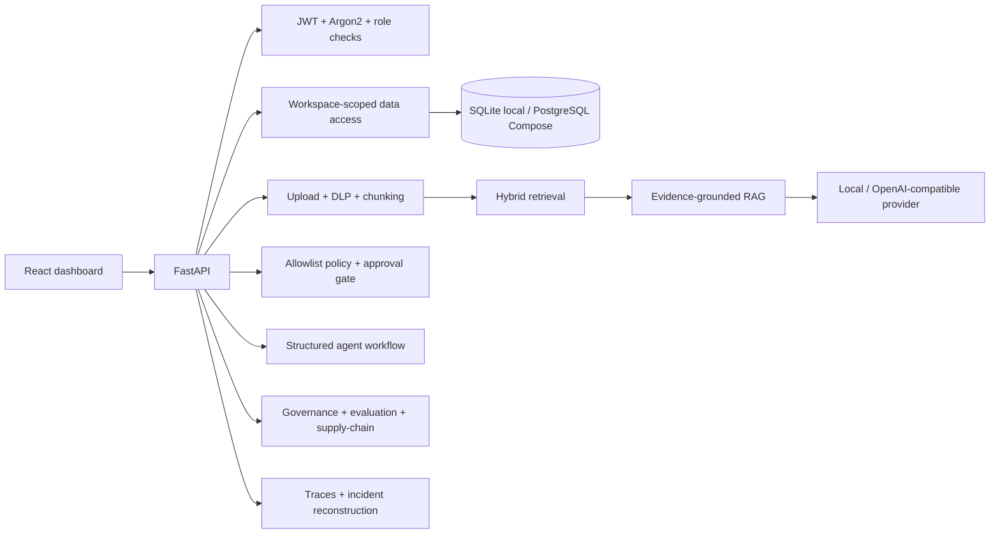

# AgentShield — Secure Agentic RAG & AI Governance Platform

AgentShield is a full-stack application for building and inspecting a security-controlled, evidence-grounded AI workflow. It includes a React/TypeScript dashboard, FastAPI service, SQLAlchemy persistence, JWT authentication, organization-scoped records, document ingestion, hybrid retrieval, provider adapter, policy gate, approvals, DLP, memory controls, structured multi-agent workflow, claim evidence checks, red-team control suite, governance register, dependency inventory, regression checks, traces, and read-only incident reconstruction.

This is a complete local-deployable portfolio application with working local-mode paths. It is not represented as independently certified, penetration-tested, or production-deployed. The README's capability notes identify where external infrastructure or stronger production controls are required.

## 1. What is implemented

| Area | Included implementation |
|---|---|
| Identity & access | Argon2 password hashing, JWT authentication, member/admin roles, configurable bootstrap admin, workspace-scoped data queries |
| Document intelligence | TXT/MD/PDF ingestion, upload limits, text extraction, DLP redaction before indexing, chunking, deletion |
| RAG | Hybrid lexical + deterministic feature-hash retrieval, ranking, source excerpts, citations, evidence abstention in local mode |
| Model adapter | Deterministic local extractive provider and configurable OpenAI-compatible chat-completions provider |
| Behavioral firewall | Server-side allowlisted tool policy, role checks, sensitive-argument rejection, approval records; no arbitrary shell/code execution |
| Human oversight | Pending approval queue, admin-only approval decisions, decision trace |
| DLP | Email, phone, API-key-like and private-key marker detection; redaction at ingestion and response boundaries; interactive scanner |
| Memory governance | User-scoped memory create/list/delete, sensitive-content rejection, 30-day expiry |
| Multi-agent workflow | Supervisor, research, analysis, verification and security stages with structured outputs and organization-scoped retrieval |
| Claim verification | Claim-by-claim evidence candidate lookup against indexed chunks, with explicit heuristic limitations |
| Red-team lab | Synthetic local control checks for instruction markers, DLP and tool allowlisting; persisted run history |
| Evaluation lab | Repeatable DLP regression cases and pass/fail results |
| Governance center | Evidence register and informational NIST AI RMF / OWASP LLM / ISO 42001 crosswalks (not certification) |
| Supply-chain inventory | Local dependency manifest inventory, pinned-version check and SHA-256 manifest digest (not a vulnerability database scan) |
| Observability | Request traces, latency, usage estimates, red-team and platform activity records |
| Incident response | Read-only trace reconstruction; does not repeat external side effects |
| Operations | Docker Compose, health endpoint, API schema, backend tests, CI workflow and architecture/threat-model docs |

## 2. Architecture



## 3. Run locally on Windows

Requirements: Python 3.11+, Node.js 20+, npm.

### Backend

```powershell
cd AgentShield\backend
py -3.11 -m venv .venv
.venv\Scripts\Activate.ps1
python -m pip install --upgrade pip
pip install -r requirements.txt
Copy-Item .env.example .env
```

Edit `backend/.env` before starting. Set a long random `SECRET_KEY`. To grant the first configured administrator role, set `BOOTSTRAP_ADMIN_EMAIL` to the exact email address used for registration. Without it, registrations receive the member role. A registration cannot join an already existing workspace by simply reusing its name.

```powershell
uvicorn app.main:app --reload
```

API docs: http://localhost:8000/docs

### Frontend (second terminal)

```powershell
cd AgentShield\frontend
npm install
npm run dev
```

Open http://localhost:5173, create a unique workspace, then upload a small text, Markdown, or text-extractable PDF document. The frontend defaults to `http://localhost:8000`; set `VITE_API_URL` at build time if your API uses another address.

### Docker Compose

```bash
# Set backend/.env values first, especially SECRET_KEY.
docker compose up --build
```

The Compose stack starts PostgreSQL, Redis, FastAPI, and the Vite frontend. Redis is included for infrastructure integration; current request paths do not require a Redis worker. Persistent PostgreSQL data is stored in the `pgdata` volume.

## 4. Configure a hosted model provider (optional)

Default `LLM_MODE=local` makes no external model request. It returns an extractive response from retrieved snippets and is suitable for a deterministic local walkthrough.

To use an OpenAI-compatible endpoint, set in `backend/.env`:

```dotenv
LLM_MODE=openai_compatible
LLM_BASE_URL=https://api.openai.com/v1
LLM_API_KEY=your-secret-key
LLM_MODEL=your-enabled-model-name
```

Restart the backend. Never commit `.env`, API keys, access tokens, or real customer data. The local retrieval vector is a deterministic feature-hash baseline, not a neural embedding model. A hosted LLM does not automatically make retrieval semantic; use a proper embedding provider/vector index for that deployment.

## 5. Dashboard modules

- **Overview** — workspace counts and platform status.
- **Documents** — upload and inspect indexed documents.
- **RAG Assistant** — ask evidence-grounded questions and inspect citations.
- **Red Team Lab** — execute and inspect local synthetic guardrail checks.
- **Policy & Approvals** — inspect pending tool proposals and decide them (approval requires admin role).
- **Observability** — inspect traces and request details.
- **Agent Workflow** — run the structured multi-stage orchestration path.
- **Claim Verification** — assess whether claims have candidate supporting chunks.
- **DLP Scanner** — inspect and redact sample text.
- **Memory Governance** — inspect, add and delete the signed-in user's memories.
- **Governance Center** — inspect framework crosswalk and generated evidence records.
- **Supply Chain** — inventory backend dependencies and hash the manifest.
- **Evaluation Lab** — run deterministic regression controls.
- **Incident Replay** — reconstruct a trace in read-only mode.

## 6. API surface

All routes below except `/health` and authentication registration/login require `Authorization: Bearer <access_token>`.

| Route | Purpose |
|---|---|
| `GET /health` | Health check |
| `POST /api/auth/register`, `POST /api/auth/login`, `GET /api/auth/me` | Identity |
| `POST/GET /api/documents`, `DELETE /api/documents/{id}` | Document lifecycle |
| `POST /api/chat` | RAG question and citations |
| `POST /api/tools/propose`, `GET /api/tools/approvals`, `POST /api/tools/approvals/{id}/decision` | Policy and human approvals |
| `POST /api/redteam/run`, `GET /api/redteam/runs` | Synthetic security checks and history |
| `GET /api/traces`, `GET /api/metrics/summary` | Observability |
| `GET/POST /api/memory`, `DELETE /api/memory/{id}` | Memory governance |
| `GET /api/platform/dashboard` | Module and workspace summary |
| `POST /api/platform/agents/run` | Structured multi-agent workflow |
| `POST /api/platform/claims/verify` | Claim evidence candidates |
| `POST /api/platform/dlp/scan` | DLP scan and redaction |
| `POST /api/platform/evaluations/run` | Regression suite |
| `GET /api/platform/governance` | Governance crosswalk and evidence |
| `POST /api/platform/supply-chain/scan` | Local manifest inventory |
| `POST /api/platform/incidents/replay` | Read-only trace reconstruction |
| `GET /api/platform/records` | Workspace-scoped feature records |

## 7. Run tests

```bash
cd backend
pytest -q
```

The CI workflow runs the backend tests with SQLite. Frontend production build can be checked with `cd frontend && npm install && npm run build`.

## 8. Important engineering boundaries

- The policy gate only authorizes registered tool proposals. This project deliberately does not execute arbitrary shell commands, scripts, or unrestricted network actions.
- The multi-agent workflow is a structured orchestration pipeline with separate result stages; it does not expose private chain-of-thought and does not claim autonomous general-purpose agents.
- Claim verification uses lexical overlap against indexed chunks. `supported_candidate` means a likely evidence match, not proof that a claim is true.
- The red-team and regression suites validate selected local controls. They are not proof of jailbreak resistance or a substitute for a security assessment.
- The dependency inventory hashes the local manifest and checks pinning. It does not query a live CVE database or establish that dependencies are vulnerability-free.
- Framework crosswalks are informational evidence organization, not NIST/ISO/OWASP certification or compliance attestation.
- The incident replay endpoint reconstructs stored trace metadata and intentionally does not repeat external side effects.
- Current local retrieval uses deterministic feature hashing. For higher-quality production retrieval, integrate a real embedding service and a vector store such as pgvector, then evaluate on a representative dataset.
- Before internet-facing deployment, configure TLS, managed secrets, strict CORS, rate limiting, MFA/account recovery, database backups and restore tests, malware scanning, file parser isolation, immutable audit retention, monitoring/alert delivery, and independent security review. Configure and test your own provider credentials and infrastructure.

## 9. Repository map

```text
AgentShield/
  backend/app/api/        FastAPI route modules
  backend/app/core/       configuration, database and authentication
  backend/app/services/   retrieval, LLM adapter, DLP, policy, evaluation and tracing
  backend/tests/          backend regression tests
  frontend/src/           React dashboard and styling
  docs/                   architecture, threat model, ADRs, demo walkthrough and feature matrix
  docker-compose.yml      local multi-service deployment
```

## 10. Suggested demo sequence

1. Register a unique workspace (set `BOOTSTRAP_ADMIN_EMAIL` first if you need admin approval capability).
2. Upload a sample policy or knowledge document.
3. Ask a question and inspect its citations and trace.
4. Run the synthetic red-team and regression suites.
5. Scan sample text with the DLP module.
6. Run the multi-agent workflow and claim verification.
7. Inspect the governance register and supply-chain inventory.
8. Reconstruct a trace using the Incident Replay module.

Educational portfolio project. Add a license before public redistribution.
